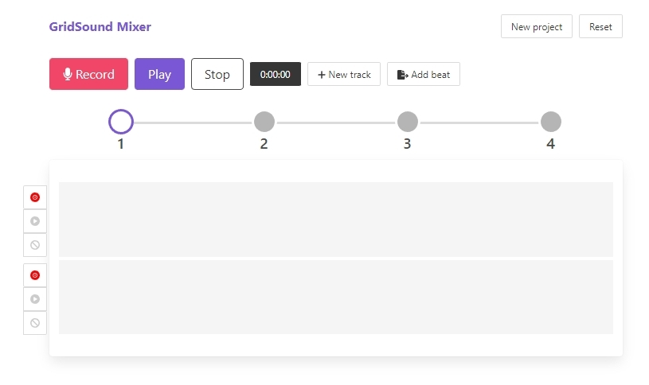

Собрал старые репозитории в один проект [@webmusic](https://github.com/users/evgenykon/projects/7) и оживил
репозиторий [SoundMixer](https://github.com/evgenykon/sound-mixer).

Хочу сделать веб-микшер с низкой задержкой при записи лупов.

Как? Пока не знаю. Но немного UI уже готово.

WebAudio API — точка моего исследования.

