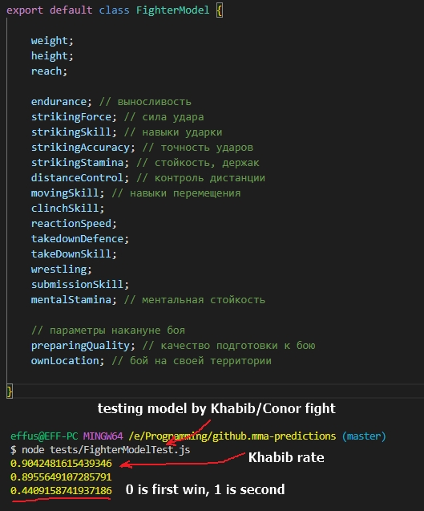

Изучаю машинное обучение :) Это интересно, знаете ли. Очень. Посмотрите.

Это предсказание знаменитого боя Хабиб — Конор в октябре 2018-го. И конечно, бой уже в прошлом, я понимаю, что
это нечестно. Но хорошо для теста нейросети. Параметры активации нейронов взяты из моего собственного мнения,
но хочется верить, что такие значения можно найти в каких-то конкретных исследованиях аналитиков.

Модель я построил на библиотеке [Synaptic](https://github.com/cazala/synaptic/wiki/Networks#neurons) для JS.

Так что продолжаю исследовать машинное обучение (и ищу хороший датасет). Хочу подготовить какие-то ценные
предсказания к следующему событию (Чимаев — Диаз). Не уверен, но хочу успеть.

Добро пожаловать в новый репозиторий в моём Github (ссылка в шапке этой страницы).
