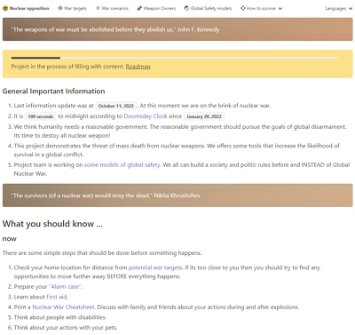

Для меня это очень важная тема. И очень страшная. Ядерная война.

Я думаю о том, что могу сделать со всем этим кошмаром за окном. И мой вариант — сделать небольшой проект, где я
могу высказать свою позицию.

Думаю, мне нужно собрать факты о мировом ядерном арсенале, целях, политике, которая может уничтожить всё. И
сделать с этим что-то, например — идеи, как этому противостоять, как защитить себя, спасти человеческие жизни.

Как было бы здорово объединиться против ядерного безумия.

Я только начал, так что некоторые страницы сайта пока пустые.

Но всё же [заходите](https://subtle-elf-215f75.netlify.app/).
