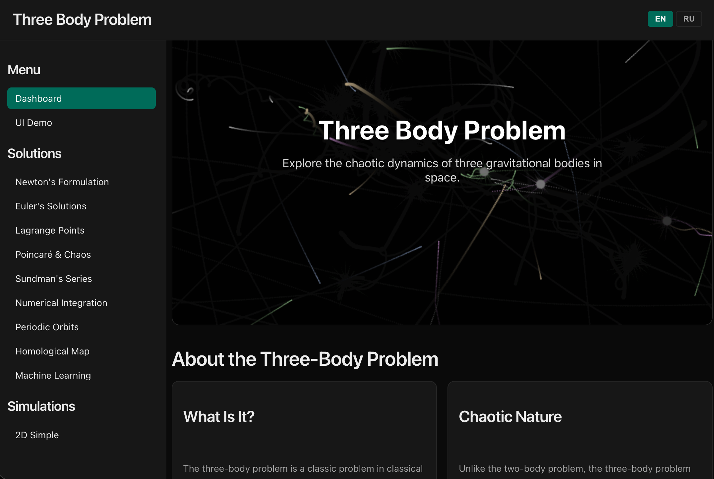

Запустил новый пет-проект — интерактивное веб-приложение, исследующее **задачу трёх тел** в небесной механике.

**Попробовать:** [evgenykon.github.io/three-body-problem](https://evgenykon.github.io/three-body-problem/)

Сделано на **Nuxt 4**, **Vue 3** и **TypeScript**: приложение совмещает движок 2D-физики в реальном времени с
образовательным гайдом, покрывающим 300+ лет исследований — от классической формулировки Ньютона (1687) до
современных подходов на машинном обучении.

### Интерактивная симуляция

- Три численных интегратора: Эйлер, RK4, Velocity-Verlet
- Настраиваемые гравитационная постоянная, шаг времени и параметр смягчения
- Детект столкновений, предсказание траекторий и визуализация следов
- Выбор тела с заданием позиции/скорости, зум и сетка
- Тёмная тема на чистом CSS, без внешнего UI-фреймворка

### Каталог периодических орбит

10 заранее рассчитанных семейств орбит (Figure-8, Butterfly I, Bumblebee, Moth I–III, Goggles, Dragonfly, Yarn,
Yin-Yang I), сгенерированных офлайн методом Velocity-Verlet с высокой точностью и воспроизводимых в рантайме
для идеальной стабильности.

### Образовательный контент

9 подробных страниц: закон Ньютона, ограниченное решение Эйлера, точки Лагранжа L1–L5, теория хаоса Пуанкаре,
сходящийся ряд Сундмана, методы численного интегрирования, гомологическая классификация и предсказание орбит
нейросетями.

### Стек

- **Фреймворк:** Nuxt 4 с Vue 3, TypeScript
- **Физика:** собственный 2D N-body движок
- **Рендеринг:** HTML5 Canvas
- **Математика:** KaTeX для формул LaTeX
- **i18n:** полные переводы на английский и русский
- **Контейнеризация:** Docker Compose
- **Деплой:** GitHub Actions → GitHub Pages

[Исходники на GitHub](https://github.com/evgenykon/three-body-problem) | [Живая демка](https://evgenykon.github.io/three-body-problem/)
