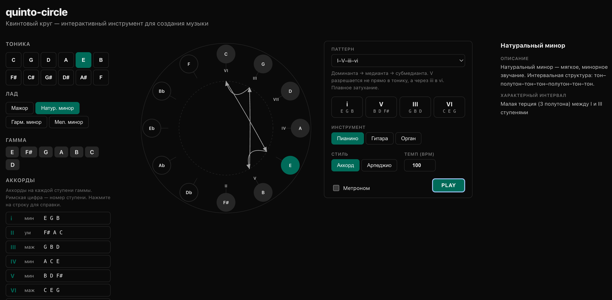

Запустил новый пет-проект — интерактивное веб-приложение **круг квинт** для музыкантов и тех, кто учится музыке.
(Изначально проект назывался Quinto Circle, сейчас это Music Tools.)

**Попробовать:** [evgenykon.github.io/music-tools](https://evgenykon.github.io/music-tools/)

Сделано на **Nuxt 4**, **Vue 3** и **TypeScript**: приложение визуализирует круг квинт с воспроизведением звука
в реальном времени и гармоническим анализом.

### Возможности

- **Выбор тональности** — мажор и минор с полным гармоническим анализом
- **Гаммы и аккорды** — ноты, интервалы и аккорды для любой тональности
- **Паттерны прогрессий** — встроенные прогрессии для классики, попа, джаза и не только
- **Выбор инструмента** — пианино, гитара, орган
- **Движок воспроизведения** — аккордами или арпеджио, с темпом и метрономом
- **Интерактивная визуализация** — клик по любой точке круга, чтобы услышать и изучить

### Стек

- **Фреймворк:** Nuxt 4 с Vue 3, TypeScript
- **Аудио:** Web Audio API и Tone.js
- **Стили:** собственный CSS
- **Деплой:** GitHub Actions → GitHub Pages

[Исходники на GitHub](https://github.com/evgenykon/music-tools) | [Живая демка](https://evgenykon.github.io/music-tools/)
