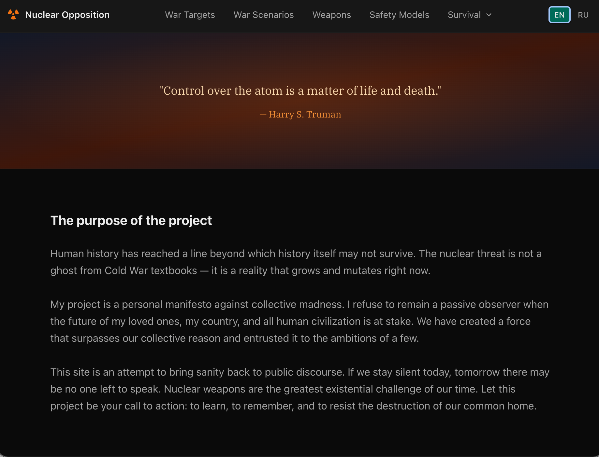

**Nuclear Opposition** — личный манифест против коллективного безумия. Сайт посвящён ядерной угрозе: сценарии,
оружие, информация о выживании.

**Попробовать:** [evgenykon.github.io/nukeopp](https://evgenykon.github.io/nukeopp/)

### О проекте

Человеческая история подошла к черте, за которой может перестать существовать сама история. Ядерная угроза —
не призрак из учебников холодной войны, это реальность, которая растёт и мутирует прямо сейчас.

Этот проект — попытка вернуть трезвость в публичный разговор. Мы создали силу, превосходящую наш коллективный
разум, и доверили её амбициям немногих.

Ядерное оружие — главный экзистенциальный вызов нашего времени. Пусть этот проект будет призывом к действию:
узнавать, помнить и противостоять уничтожению нашего общего дома.

[Исходники на GitHub](https://github.com/evgenykon/nukeopp) | [Живая демка](https://evgenykon.github.io/nukeopp/)
