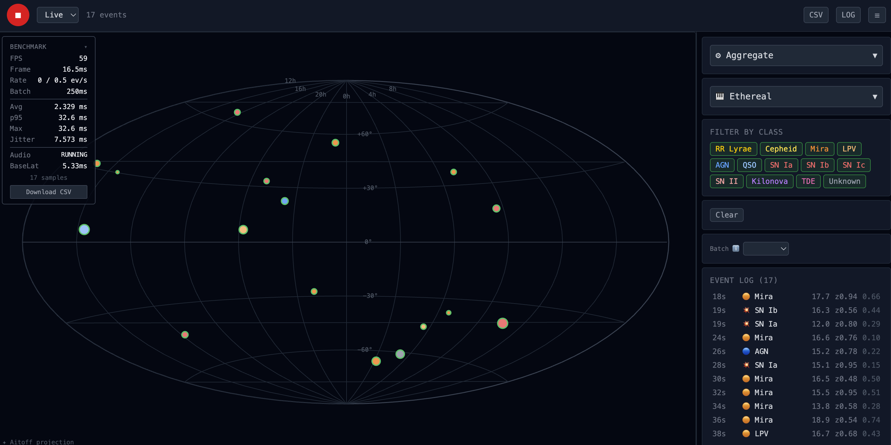

Сонализация алертов ZTF (а в будущем и LSST) в реальном времени, сделанная ради доступности.

Каждую ночь обсерватория обнаруживает сотни тысяч транзиентных событий. Это приложение превращает такой поток в
пространственный звук: форма волны кодирует тип объекта, высота тона — красное смещение, громкость — звёздную
величину, а 3D-панорама — положение на небе.

Слабовидящие учёные могут классифицировать события на слух. Зрячие исследователи — следить за потоком, пока
читают или пишут. Любой может почувствовать ритм транзиентного неба.

18 классов объектов, 8 звуковых палитр, Web Audio API, Vue 3, Bun + KafkaJS. Docker + Hugging Face Spaces +
GitHub Pages.

**Попробовать:** https://evgenykon.github.io/alert-data-to-sound-mapping/#/

**Исходники:** https://github.com/evgenykon/alert-data-to-sound-mapping
