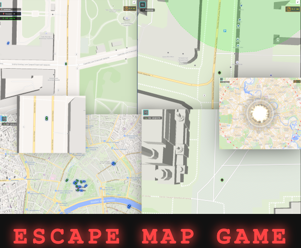

Браузерная игра-побег по карте (MapLibre + тайлы OpenFreeMap): игрок должен добраться до укрытия раньше, чем
рванёт в случайном эпицентре.

Игра использует геолокацию, тянет дороги и здания из Overpass API в радиусе ~15 км, строит граф дорог и ставит
одно укрытие в 1.5–2 км от эпицентра. На некоторых машинах можно ездить (клавиша E), запертые машины можно
взломать (удерживать E). У транспорта есть топливо и физика (занос, штраф вне дороги). Заправка — на АЗС.

Управление: WASD — движение, Shift — бег, мышь — поворот камеры, E — взаимодействие (сесть/выйти из машины,
начать/отменить взлом), M — режимы карты (следование, обзор, тактика). HUD показывает таймер, SMS со сценарием,
компас до укрытия и уровень топлива.

В момент взрыва: внутри укрытия — победа, иначе — поражение.

Стек: TypeScript, Vite 5, Vue 3 (Composition API), Pinia, MapLibre GL JS, Turf.js, Docker.

**Играть:** https://evgenykon.github.io/escape-map-game/
**Исходники:** https://github.com/evgenykon/escape-map-game
