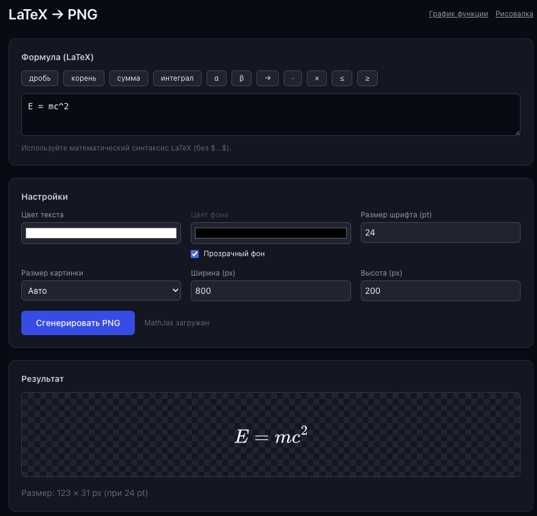
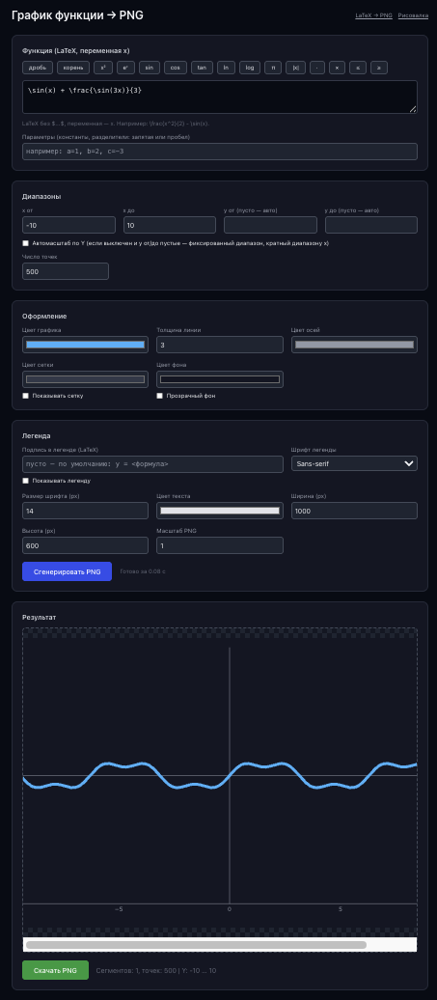

Одностраничный инструмент для конвертации формул LaTeX в PNG прямо в браузере.
Без бэкенда: рендеринг делает MathJax 3 (SVG), после чего картинка переносится в `<canvas>`
и сохраняется как PNG.

Возможности: ввод формулы с кнопками быстрых шаблонов (дробь, корень, сумма, интеграл, греческие буквы),
выбор цвета текста и фона, включая полностью прозрачный фон (альфа-канал), размер шрифта, авторазмер или
подгонка под изображение, живое превью и скачивание в один клик, тёмная тема (Tailwind CSS).

Вторая страница (`plot.html`) рисует графики функций на Plotly.js с нативным LaTeX в легенде:
формула разбирается в JS-функцию движком @cortex-js/compute-engine, поддерживаются константы
(`a=1, b=2, c=-3`), переключатель автомасштаба по Y, стилизация легенды/осей/сетки, прозрачный фон
и разрыв в точках разрыва для `\tan(x)` и `1/x`.

Третья страница (`draw.html`) — рисовалка: ручка, маркер, мягкая кисть и ластик, размер и цвет кисти,
размер холста, отмена и очистка, прозрачный фон и экспорт PNG в масштабе ×1–×4.

Стек: MathJax 3, Plotly.js, compute-engine, Tailwind CSS, GitHub Pages.

**Исходники:** https://github.com/evgenykon/latex-2-png

**LaTeX -> PNG**

Попробовать: https://evgenykon.github.io/latex-2-png/index.html

**График функции**

Попробовать: https://evgenykon.github.io/latex-2-png/plot.html

