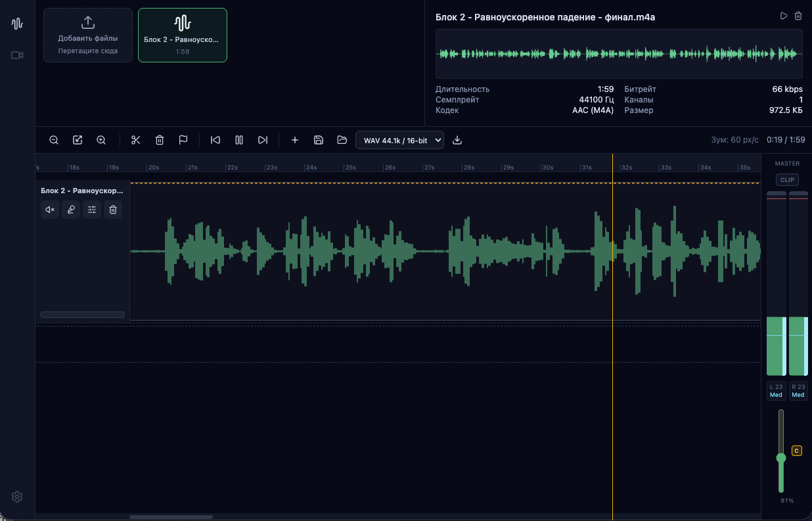

Nuxt 4 SPA с браузерными инструментами для аудио. Главная фича — AudioCropper: многодорожечный редактор с
отрисовкой волноформы на canvas, разрезанием клипов, эффектами на дорожку и сохранением/загрузкой проекта в
виде файлов `.mwtproj`.

Всё работает в браузере, проекты можно сохранять и открывать из интерфейса, а прод деплоится через
GitHub Actions на GitHub Pages.

Стек: Nuxt 4 (Vue 3), TypeScript, отрисовка на canvas, Docker, GitHub Pages.

**Попробовать:** https://evgenykon.github.io/media-web-tools/
**Исходники:** https://github.com/evgenykon/media-web-tools

