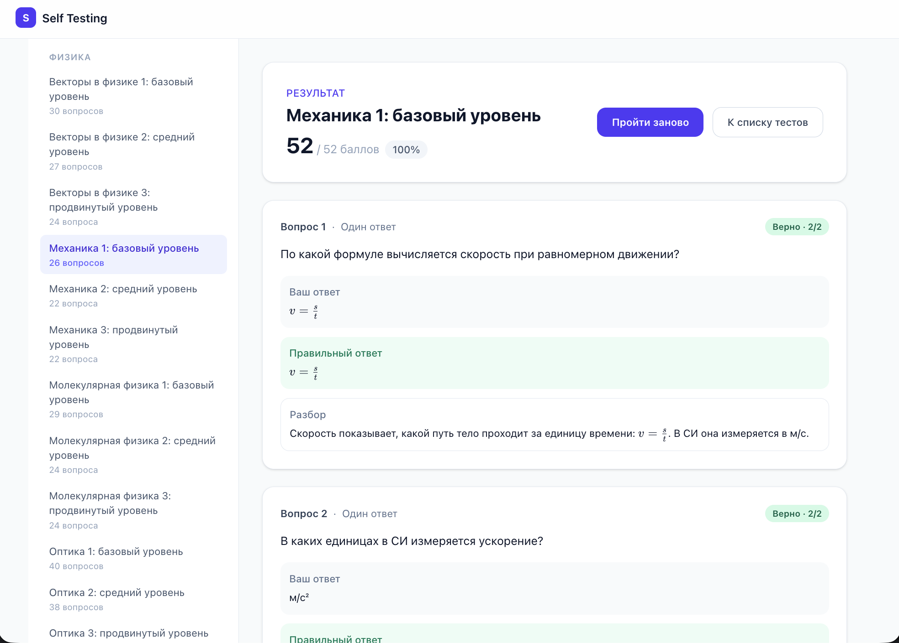

Статичный сайт с квизами по разным темам: Nuxt 4 SPA, задеплоен на GitHub Pages.

Квизы сгруппированы по темам с индексом в сайдбаре; одна страница = один квиз. Поддерживаются три типа вопросов:
один вариант, несколько вариантов и ввод текста. Вопросы, ответы и пояснения поддерживают markdown, картинки и
формулы LaTeX (KaTeX, рендерится на этапе сборки).

У каждого квиза может быть таймер на весь тест или на вопрос, с прогресс-баром сверху. Оценка 0/1/2, а на
странице результатов разбирается каждый ответ. Вопросы и варианты перемешиваются при каждом запуске, попытки
хранятся локально: на странице статистики — графики истории по квизам со сбросом. Кнопка «Не знаю» помечает
вопрос, и помеченные собираются на странице разбора с правильными ответами и пояснениями.

Исходники квизов — обычные markdown-файлы (`content/tests/*.md`), скрипт сборки парсит их, рендерит
KaTeX/markdown в HTML и обфусцирует данные (XOR + Base64 со случайным ключом на сборку) до того, как Nuxt
сгенерирует статические страницы. Ещё есть промпт для LLM, который конвертирует любой файл или веб-страницу в
квиз в поддерживаемом формате.

Всё работает внутри Docker (`make install`, `make build`, `make test`), а пуш в `main` деплоит на GitHub Pages
через GitHub Actions.

Стек: Nuxt 4.6, TypeScript, Tailwind CSS 4, markdown-it, KaTeX, Vitest, Docker Compose.

**Попробовать:** https://evgenykon.github.io/self-testing/

**Исходники:** https://github.com/evgenykon/self-testing
